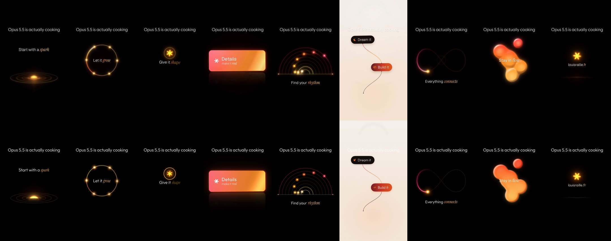
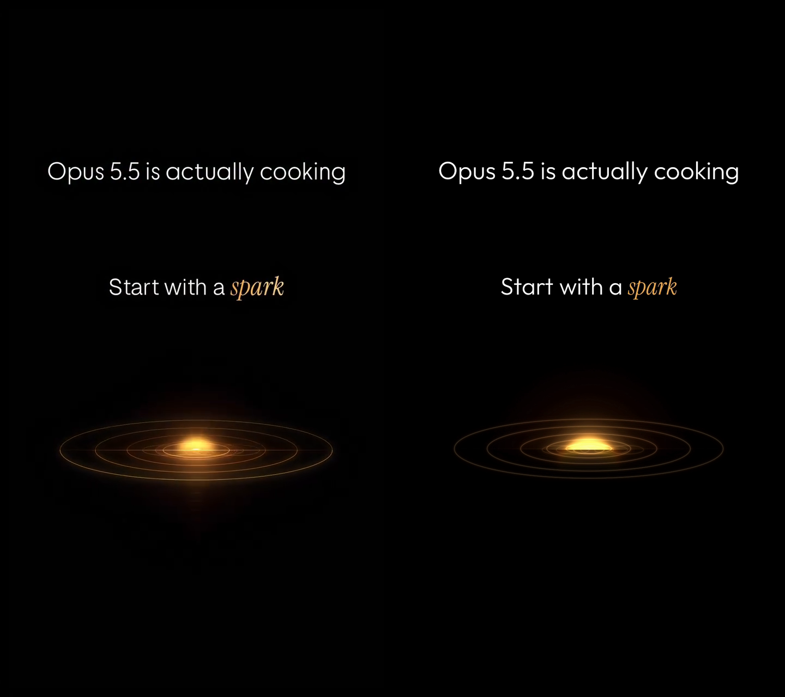
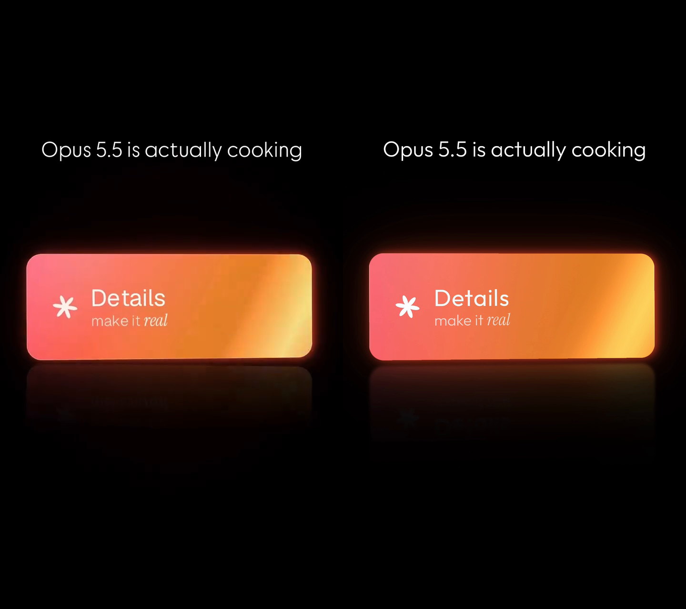
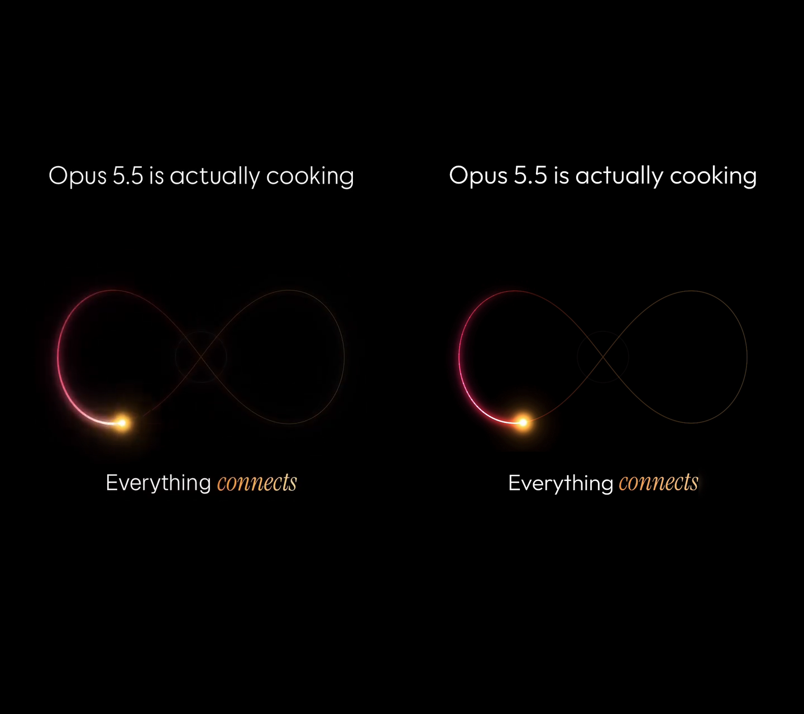
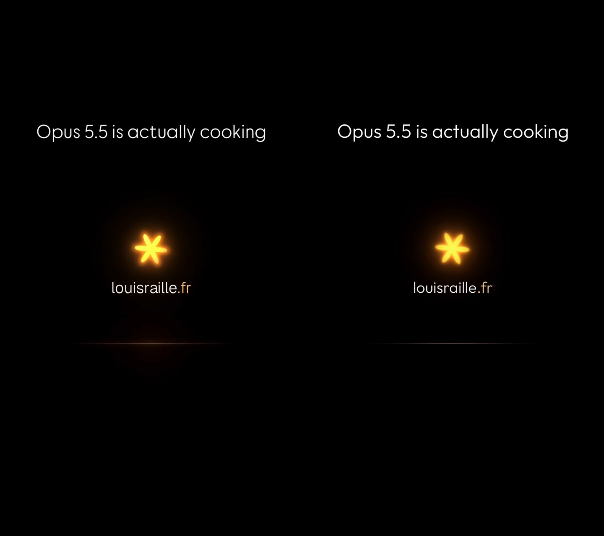

# SwiftUI Glow Animations

Nine glowing motion-design scenes, rebuilt in SwiftUI frame for frame from a 31.7 s reel, as a Swift package you can drop into an iOS app. Every scene is a pure function of time, so the same code plays, loops, scrubs, slows down or runs backwards without any animation state.

Recreates the motion design of a reel by Louis Raille (louisraille.fr) as a SwiftUI study; not affiliated with or endorsed by the author.

## What it looks like

Reference on the left, this package rendered on the iOS simulator on the right.



| | |
|---|---|
|  |  |
|  |  |

Videos: [our reel](samples/reel.mp4) and the [side-by-side with the reference](samples/side-by-side.mp4).

| # | Scene | Caption | Length |
|---|---|---|---|
| 1 | Spark | Start with a *spark* | 3.47 s |
| 2 | Grow | Let it *grow* | 2.87 s |
| 3 | Shape | Give it *shape* | 1.83 s |
| 4 | Details | Details, make it *real* | 2.37 s |
| 5 | Rhythm | Find your *rhythm* | 5.13 s |
| 6 | Workflow | Dream, Build, Ship | 5.10 s |
| 7 | Connects | Everything *connects* | 3.73 s |
| 8 | Flow | Stay in *flow* | 4.00 s |
| 9 | Outro | louisraille.fr | 3.17 s |

## Using it in your app

Add the package (`Package.swift`, iOS 17+) and import `GlowAnimations`.

```swift
import GlowAnimations

// Play one scene, looping, driven by the display clock.
GlowPlayer(scene: .connects)

// Play the whole reel once.
GlowPlayer(.reel, loop: false)

// Drive time yourself: scrub with a slider, slow it down, run it backwards.
GlowStage {
    GlowSceneView(scene: .flow, t: sliderValue * GlowScene.flow.duration, showsTitle: false)
}
```

- `GlowStage` draws its content in a fixed 720 × 1280 design space and letterboxes it into whatever frame you give it, so scenes look identical on every device.
- `GlowSceneView(scene:t:showsTitle:)` renders scene-local time `t` in seconds. `GlowReelView(t:)` does the same for reel time, with `GlowScene.locate(reelTime:)` mapping into a scene.
- `GlowPlayer` wraps either in a `TimelineView` and adds `loop`, `startOffset`, and an `onStart` callback with the wall-clock date of t = 0.
- `ReelTitle(text:)` is the title drawn over every scene; pass `showsTitle: false` and draw your own.
- The Outfit and Instrument Serif fonts are bundled and registered on first use.

### Variations

Because nothing is stateful, variations are a matter of what time you feed in and what you compose around it:

- **Standalone loops**: any scene loops cleanly on its own (`GlowPlayer(scene:)`); Spark, Rhythm, Connects and Flow work as ambient loaders.
- **Scrub and slow motion**: bind `t` to a gesture or a slider; a `startOffset` lets a scene begin mid-way.
- **Reverse and ping-pong**: feed `duration - t`, or a triangle wave, into `GlowSceneView`.
- **Your own words**: `ReelTitle(text:)` for the title; scene captions sit in each `Scenes/<Name>Scene.swift` and are plain `Text` runs.

## Demo app

`Demo/GlowAnimationsDemo.xcodeproj` lists every scene and the full reel, plays them full screen with close, restart and loop controls, and is localised in en, en-GB, en-AU, en-CA and es-MX. Launch arguments `-glow-scene <spark|grow|…>`, `-glow-reel` and `-glow-chromeless` open a program directly (the harness uses the last one).

## How the match was verified

`docs/storyboard/` holds a frame-accurate spec per scene, measured from the reference at 30 fps: positions, radii, colours, easing laws and the key frames to hit. The implementation was then recorded on an iPhone simulator with `tools/record.sh`, which reads a per-frame binary timecode the demo app draws outside the stage, so every captured frame maps to an exact program time. `tools/compare-sheet.sh` builds the reference-versus-ours sheets, and the agents fitted positions and colours to the measured frames until they agreed within a few pixels and a frame. Where the spec and the reference disagreed, the reference won. See `docs/architecture.md`.

## Licence

Code is MIT licensed (see `LICENSE`). The bundled Outfit and Instrument Serif fonts are under the SIL Open Font License 1.1; their licence files sit next to the fonts in `Sources/GlowAnimations/Resources/Fonts`. The reference video and its frames are not included.
